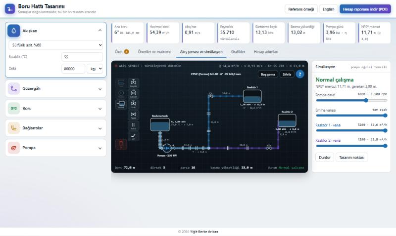
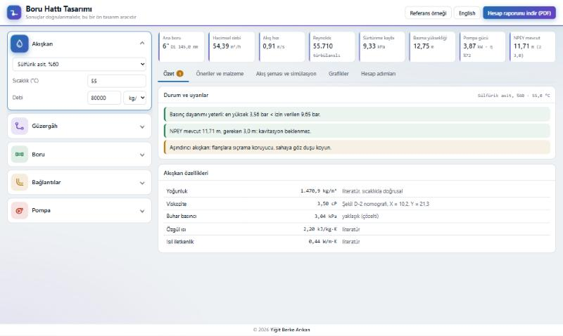
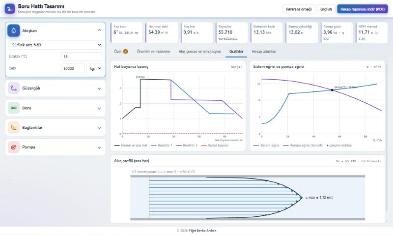

# Pipeline Design

**English** · [Türkçe](README.tr.md)

An offline preliminary-design tool for process plant pipelines. Enter the fluid and the route; the program proposes the pipe size and material, valves and pump, draws the flow diagram, simulates the line and exports the full calculation as a PDF report.



## Download

| File | For | How to open |
|---|---|---|
| [PipelineDesign.exe](PipelineDesign.exe) | Windows 10 and 11 | Download and double-click. No installation. |
| [pipeline-design.html](pipeline-design.html) | Any device (Windows, Mac, Linux, phone) | Download and double-click; it opens in your browser. |

Both are the same program and neither needs an internet connection. To download a file, click its link and use the download button at the top right of the page that opens.

The interface starts in Turkish; press the **English** button at the top right to switch.

The `.exe` is not digitally signed. If Windows shows "Windows protected your PC" on first launch, choose **More info → Run anyway**. The `.exe` opens the program in its own window drawn by Microsoft Edge; without Edge it uses Chrome or your default browser.

## Why you can trust it

The project is open source under the MIT License, and everything the program does is in this repository:

- The whole program is one readable file, [pipeline-design.html](pipeline-design.html). It contains no external scripts, sends nothing over the network and stores nothing about you.
- The `.exe` is only a small launcher. Its complete source is [src/launcher.cs](src/launcher.cs) (about 60 lines): it writes the HTML file to your user data folder and opens it in a browser window.
- You can rebuild the `.exe` yourself from this source with one command (see [Building from source](#building-from-source)), using the compiler that ships with Windows.

## What it does

- **Fluid selection:** 35 liquids (acids, bases, solvents, brines, water) plus a custom fluid whose properties you enter. Density, viscosity and vapor pressure are computed for the temperature you give.
- **Single or branched lines:** tank → pump → one destination, or distribution from a tee to 2–4 branches. Each branch pipe is sized for its own flow; the pump is sized for the hardest branch.
- **Automatic recommendations:** pipe material and standard size, isolation valve, check valve, control valves, gasket, pump type and material, motor size, insulation. Each recommendation comes with its reason.
- **Material compatibility:** a table of chemical resistance ratings (A–D) for each material with the fluid you chose, and why each was accepted or rejected.
- **Warnings:** cavitation, pressure rating, temperature limit, velocity range, flammable and corrosive fluids.
- **Editable flow diagram:** build the diagram yourself. Drag a tank, pump and destinations from the box onto the canvas and the pipes connect themselves; press and drag a pipe to bend it (every corner counts as a 90° elbow); drop valves, check valves and unions onto the pipes. The diagram is to scale, and lengths, elevations, elbows and fittings are read from it for the calculation. **Reset** restores the ready-made diagram, **Blank** starts from an empty canvas, and the **?** button shows how it works.
- **Simulation:** change the pump speed and valve openings and see the operating point, flow split and cavitation state update at once.
- **Charts:** pressure along the line, system curve with pump curve, velocity profile inside the pipe.
- **Calculation steps and PDF report:** every value is shown with the data and the relation it comes from, with formulas and numbers; one button downloads it as a PDF.
- **Turkish and English** interface.





## How to use it

1. In the menus on the left, enter the fluid, temperature and flow rate.
2. Open the **Flow diagram and simulation** tab and arrange the diagram by dragging, or type exact values in the **Route** menu (they match the symbols on the sketch: P₁, h₁, L₁ …). The two stay in sync.
3. Read the results in the tabs on the right: Summary, Recommendations and materials, Flow diagram and simulation, Charts, Calculation steps.
4. Press **Download calculation report (PDF)** to get the report.

The **Reference example** button loads the design the program was checked against: 60% sulfuric acid at 55 °C, 80,000 kg/h, from a tank at 1 atm to a reactor at 1.3 atm.

## Calculation method

| Step | Method |
|---|---|
| Viscosity | Liquid viscosity nomograph (Peters & Timmerhaus, Table D-3 and Fig. D-2) |
| Economic pipe diameter | Relation behind the optimum-diameter nomograph (Peters & Timmerhaus, Fig. 12-3); for steel pipe, compared with Towler & Sinnott Eqs. 20.30–20.31 |
| Friction factor | Colebrook equation; f = 8/Re for laminar flow |
| Fitting losses | Equivalent pipe diameters (Towler & Sinnott, Table 5.3) |
| Head and power | Mechanical energy balance; pump efficiency from Fig. 5.13 |
| Pump type | Specific speed |
| Cavitation | Net positive suction head (NPSH) |
| Material and gasket | Graco Chemical Compatibility Guide ratings; manufacturer data for PVC and CPVC |
| Heat loss and insulation | Dittus–Boelter relation, pipe wall and insulation resistance, still air |

Sources: Towler & Sinnott, *Chemical Engineering Design*; Peters, Timmerhaus & West, *Plant Design and Economics for Chemical Engineers*; Graco *Chemical Compatibility Guide*; Perry's *Chemical Engineers' Handbook*.

## Limits

- Results must be verified; this is a preliminary design tool.
- Liquids only; gas and steam lines are not covered.
- The pump curve in the simulation is illustrative, not a catalogue curve of a real pump.
- Density, vapor pressure and the pressure ratings of plastic pipe are general literature and manufacturer values and should be treated as approximate.
- The only cost computed is annual energy use.

## Building from source

The whole program is `pipeline-design.html`. The `.exe` is a small launcher (`src/launcher.cs`) with that file embedded. To rebuild it on Windows without installing anything:

```powershell
powershell -ExecutionPolicy Bypass -File build.ps1
```

## License

[MIT License](LICENSE) · © 2026 Yiğit Berke Arıkan
