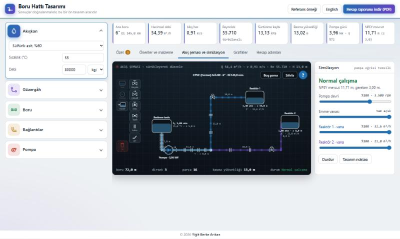
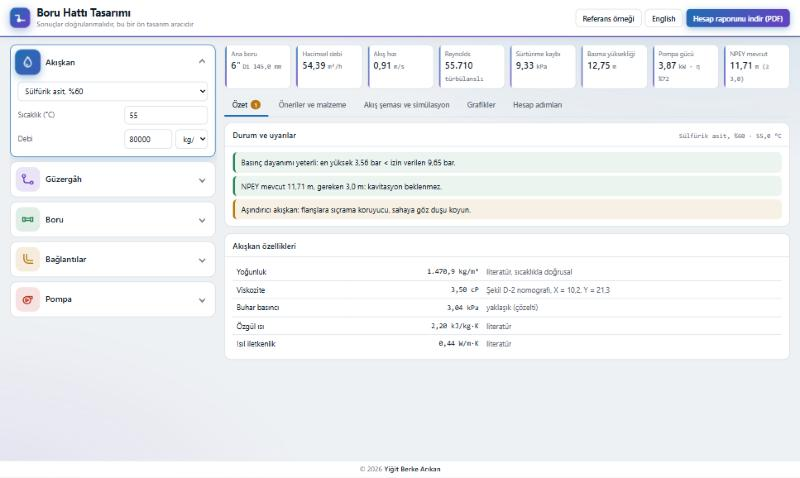
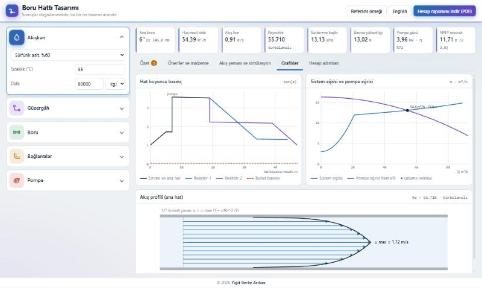

# Boru Hattı Tasarımı (Pipeline Design)

[English](README.md) · **Türkçe**

Kimya tesisleri için boru hattı ön tasarımı yapan, internetsiz çalışan bir program. Akışkanı ve güzergâhı girersiniz; program boru çapını, malzemeyi, vanaları ve pompayı önerir, akış şemasını çizer, hattı simüle eder ve hesabın tamamını PDF rapor olarak verir.



## İndirme

| Dosya | Kimler için | Nasıl açılır |
|---|---|---|
| [PipelineDesign.exe](PipelineDesign.exe) | Windows 10 ve 11 | İndirip çift tıklayın. Kurulum yok. |
| [pipeline-design.html](pipeline-design.html) | Her cihaz (Windows, Mac, Linux, telefon) | İndirip çift tıklayın; tarayıcıda açılır. |

İkisi de aynı programdır ve internet gerektirmez. Dosyayı indirmek için bağlantıya tıklayıp açılan sayfada sağ üstteki indirme düğmesini kullanın.

`.exe` dosyası dijital olarak imzalı değildir. Windows ilk açılışta "Windows kişisel bilgisayarınızı korudu" uyarısı gösterirse **Ek bilgi → Yine de çalıştır** ile devam edin. `.exe`, programı Microsoft Edge'in çizdiği kendi penceresinde açar; Edge yoksa Chrome'u ya da varsayılan tarayıcıyı kullanır.

## Neden güvenebilirsiniz

Proje MIT Lisansı ile açık kaynaklıdır ve programın yaptığı her şey bu depodadır:

- Programın tamamı okunabilir tek bir dosyadır: [pipeline-design.html](pipeline-design.html). Dışarıdan betik yüklemez, ağa hiçbir şey göndermez, sizinle ilgili hiçbir şey saklamaz.
- `.exe` yalnızca küçük bir başlatıcıdır. Kaynağının tamamı [src/launcher.cs](src/launcher.cs) dosyasındadır (yaklaşık 60 satır): HTML dosyasını kullanıcı veri klasörünüze yazar ve bir tarayıcı penceresinde açar.
- `.exe` dosyasını bu kaynaktan, Windows ile gelen derleyiciyle tek komutla kendiniz derleyebilirsiniz ([Kaynak koddan derleme](#kaynak-koddan-derleme)).

## Ne yapar

- **Akışkan seçimi:** 35 sıvı (asitler, bazlar, çözücüler, tuzlu sular, su) ve özellikleri elle girilen "özel akışkan". Yoğunluk, viskozite ve buhar basıncı sıcaklığa göre hesaplanır.
- **Tek hat ya da dallanan hat:** tank → pompa → tek hedef, ya da bir T ayrımından 2–4 kola dağıtım. Her kolun borusu kendi debisine göre boyutlandırılır; pompa en zor kola göre seçilir.
- **Otomatik öneriler:** boru malzemesi ve standart çap, kapama vanası, çekvalf, ayar vanaları, conta, pompa tipi ve malzemesi, motor gücü, yalıtım. Her önerinin gerekçesi yanında yazar.
- **Malzeme uyumu:** her akışkan için malzemelerin kimyasal dayanım notu (A–D) ve seçim gerekçesi tablo olarak gösterilir.
- **Uyarılar:** kavitasyon, basınç dayanımı, sıcaklık sınırı, akış hızı aralığı, yanıcı ve aşındırıcı akışkan.
- **Düzenlenebilir akış şeması:** şemayı kendiniz kurarsınız. Tankı, pompayı ve hedefleri kutudan boş alana sürükleyin, borular kendiliğinden bağlanır; boruya basılı tutup sürükleyerek bükün (her köşe 90° dirsek sayılır); vana, çekvalf ve rakorları borunun üstüne bırakın. Şema ölçeklidir; uzunluklar, kotlar, dirsekler ve parçalar hesaba şemadan girer. **Sıfırla** hazır şemaya döner, **Boş şema** boş alandan başlatır, **?** düğmesi nasıl yapılacağını gösterir.
- **Simülasyon:** pompa devrini ve vana açıklıklarını değiştirince çalışma noktası, debi paylaşımı ve kavitasyon durumu anında güncellenir.
- **Grafikler:** hat boyunca basınç, sistem eğrisi ile pompa eğrisi, boru içindeki hız profili.
- **Hesap adımları ve PDF rapor:** her değerin hangi veriden, hangi bağıntıyla bulunduğu formül ve sayılarla gösterilir; tek düğmeyle PDF olarak indirilir.
- **Türkçe ve İngilizce** arayüz.





## Nasıl kullanılır

1. Soldaki menülerden akışkanı, sıcaklığı ve debiyi girin.
2. **Akış şeması ve simülasyon** sekmesinde şemayı sürükleyerek düzenleyin ya da kesin değerleri **Güzergâh** menüsüne yazın (çizimdeki simgelere karşılık gelir: P₁, h₁, L₁ …). İkisi birbirine bağlıdır.
3. Sağdaki sekmelerde sonuçları inceleyin: Özet, Öneriler ve malzeme, Akış şeması ve simülasyon, Grafikler, Hesap adımları.
4. **Hesap raporunu indir (PDF)** düğmesiyle raporu alın.

**Referans örneği** düğmesi, programın doğrulandığı örnek tasarımı yükler: 55 °C'de %60'lık sülfürik asit, 80.000 kg/saat, 1 atm'lik tanktan 1,3 atm'lik reaktöre.

## Hesap yöntemi

| Adım | Yöntem |
|---|---|
| Viskozite | Sıvı viskozitesi nomografı (Peters & Timmerhaus, Tablo D-3 ve Şekil D-2) |
| Ekonomik boru çapı | En uygun çap nomografının bağıntısı (Peters & Timmerhaus, Şekil 12-3); çelik borularda Towler & Sinnott Denklem 20.30–20.31 ile karşılaştırma |
| Sürtünme çarpanı | Colebrook denklemi; laminer akışta f = 8/Re |
| Bağlantı elemanı kayıpları | Eşdeğer boru çapı sayıları (Towler & Sinnott, Çizelge 5.3) |
| Basma yüksekliği ve güç | Mekanik enerji denkliği; pompa verimi Şekil 5.13'ten |
| Pompa tipi | Özgül hız |
| Kavitasyon | Net pozitif emme yüksekliği (NPEY) |
| Malzeme ve conta | Graco Chemical Compatibility Guide notları; PVC ve CPVC için üretici verisi |
| Isı kaybı ve yalıtım | Dittus–Boelter bağıntısı, boru cidarı ve yalıtım direnci, durgun hava |

Kaynaklar: Towler & Sinnott, *Chemical Engineering Design*; Peters, Timmerhaus & West, *Plant Design and Economics for Chemical Engineers*; Graco *Chemical Compatibility Guide*; Perry's *Chemical Engineers' Handbook*.

## Sınırlar

- Sonuçlar doğrulanmalıdır, bu bir ön tasarım aracıdır.
- Yalnızca sıvılar hesaplanır; gaz ve buhar hatları kapsamda değildir.
- Simülasyondaki pompa eğrisi temsilîdir, bir pompanın katalog eğrisi değildir.
- Yoğunluk, buhar basıncı ve plastik boruların basınç sınıfları genel literatür ve üretici değerleridir; yaklaşık kabul edilmelidir.
- Maliyet olarak yalnızca yıllık enerji tüketimi hesaplanır.

## Kaynak koddan derleme

Programın tamamı `pipeline-design.html` dosyasıdır. `.exe`, bu dosyayı içine gömen küçük bir başlatıcıdır (`src/launcher.cs`). Windows'ta ek bir şey kurmadan yeniden derlemek için:

```powershell
powershell -ExecutionPolicy Bypass -File build.ps1
```

## Lisans

[MIT Lisansı](LICENSE) · © 2026 Yiğit Berke Arıkan
